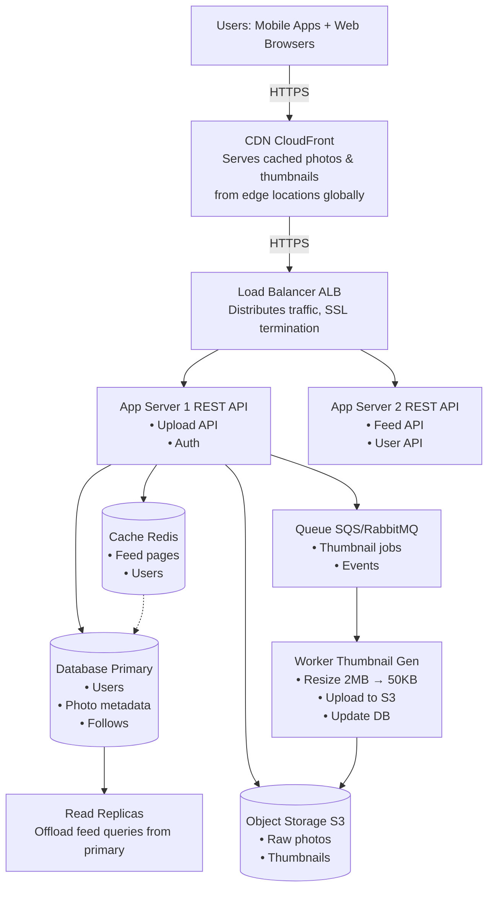

# SnapShare — Photo-App Scaling Plan (Day 7)

## 1. Assumptions

| Assumption | Value |
|---|---|
| Registered users | 10,000,000 |
| Daily active user rate | 10% of registered |
| Photos uploaded per active user per day | 1 |
| Feed pages viewed per active user per day | 50 |
| Average raw photo size | 2 MB |
| Average thumbnail size | 50 KB |
| Peak traffic multiplier | 5× average |
| Days per year | 365 |

**Daily Active Users (DAU):** 10,000,000 × 10% = **1,000,000 DAU**

---

## 2. Load Estimates

### Uploads per Second

| Metric | Value |
|---|---|
| Total daily uploads | 1,000,000 |
| Average uploads/sec | **11.57** |
| Peak uploads/sec (5×) | **57.87** |

_Calculation: 1,000,000 ÷ 86,400 seconds = 11.57 avg → 11.57 × 5 = 57.87 peak_

### Feed Views per Second

| Metric | Value |
|---|---|
| Total daily feed views | 50,000,000 |
| Average feed views/sec | **578.70** |
| Peak feed views/sec (5×) | **2,893.52** |

_Calculation: 50,000,000 ÷ 86,400 = 578.70 avg → 578.70 × 5 = 2,893.52 peak_

### Storage per Year

| Component | Daily | Yearly |
|---|---|---|
| Raw photos (2 MB each) | 1,953.13 GB | **696.18 TB** |
| Thumbnails (50 KB each) | 48.83 GB | **17.40 TB** |
| **Total** | **2,001.96 GB** | **~713.58 TB** |

_Calculation: 1,000,000 × 2 MB × 365 = 730,000,000 MB = 712.89 GB → 696.18 TB for raw photos. Thumbnails: 1,000,000 × 50 KB × 365 = 36,500,000 MB → 17.40 TB. Combined ≈ **713.58 TB per year**._

---

## 3. Read-Heavy vs Write-Heavy

**SnapShare is a read-heavy system.**

The read-to-write ratio is **50:1** — for every 1 upload (write), there are 50 feed page views (reads). This fundamentally shapes the architecture:

- **Read replicas** handle the overwhelming majority of database load (feed queries).
- **Cache (Redis)** is critical — without it, the primary database would be saturated by feed reads.
- **CDN** serves 90%+ of photo/thumbnail requests at the edge, never hitting origin.
- **App servers** scale out for reads; upload capacity (11.57 writes/sec) is trivial.
- **Write path** can use a single primary database — no sharding needed at this scale.

---

## 4. Why Photos Should Not Be Stored in the Database

Storing binary photo files (BLOBs) inside a relational database is a performance anti-pattern:

1. **Database bloat** — 713 TB of binary data makes backups, replicas, and recovery exponentially slower and costlier.
2. **Network waste** — every photo fetch consumes database connection bandwidth that should serve query results, not payloads.
3. **No built-in optimization** — databases can't transcode, resize, or deduplicate binary content.
4. **Scaling limits** — databases are hard to shard horizontally for large blobs; object storage is built for petabyte-scale horizontal growth.
5. **Cost** — database storage is orders of magnitude more expensive per GB than S3-like object storage.

**Where photos belong:** **Object storage** (e.g., Amazon S3). Object storage provides horizontal scale, 11-nines durability, lifecycle policies, CDN integration, and a fraction of the cost. The database stores only metadata — user ID, S3 key, upload timestamp, dimensions, and thumbnail URL.

---

## 5. Architecture Diagram
---                          

---

### 6. Component Breakdown (One Sentence Each)

| Component | Problem It Solves |
|---|---|
| **CDN** | Delivers photos and thumbnails from edge servers closest to users, reducing latency to under 100 ms and offloading 90%+
 of read traffic from the origin. |
| **Load Balancer** | Distributes incoming HTTP requests evenly across app server instances, performs health checks, and terminates
 SSL so app servers handle only plaintext traffic. |
| **App Servers** | Host the REST API (upload, feed, auth) and scale horizontally to absorb traffic spikes without downtime. |
| **Cache (Redis)** | Stores hot feed pages, user profiles, and session data in memory, reducing database query volume by ~80% and 
serving responses in under 10 ms. |
| **Database (Primary)** | Serves as the source of truth for all write operations — users, photo metadata, and follow relationships
 — while read replicas handle reads. |
| **Read Replica** | Offloads the read-heavy feed queries from the primary database, allowing uploads to stay fast while thousands 
of users scroll simultaneously. |
| **Object Storage (S3)** | Stores raw photo files and thumbnails at petabyte scale with built-in durability, lifecycle policies, a
nd seamless CDN integration at a fraction of DB storage cost. |
| **Queue** | Decouples the upload API from thumbnail generation so the API returns immediately and thumbnail jobs are processed at
 a controlled rate without blocking users. |
| **Worker** | Consumes queue jobs to resize raw photos into 50 KB thumbnails, uploads them to S3, and updates the database with th
e thumbnail URL — all asynchronously. |

---

## 7. Upload Flow — Step by Step

1. **User selects a photo** from their device camera roll or captures a new one within the SnapShare mobile or web app.

2. **Client authenticates the request** by attaching a valid JWT or session token in the HTTP Authorization header.

3. **Client requests a presigned URL** by sending a POST to /api/upload/presign with metadata including desired filename, content type, and file size. The load balancer routes this to an available app server.

4. **App server validates auth and quota** — checks the user's token, verifies they're within their upload quota, and confirms the provided content type (JPEG/PNG/WebP only) and size limits (max 25 MB). If invalid, returns a 400 error immediately.

5. **App server generates a presigned S3 URL** — creates a time-limited, one-use S3 upload URL via the AWS SDK, scoped to a unique key such as uploads/{user-id}/{uuid}.jpg with the correct content type. This URL expires after 60 seconds.

6. **App server inserts a placeholder metadata** record into the primary database — stores the user ID, planned S3 key, upload timestamp, and status (pending). This ensures a record exists even if the upload fails, and the UI can show "Processing..." immediately.

7. **App server enqueues a thumbnail job** to the message queue with the S3 key and user ID — the job is queued before the upload even happens, so processing starts as soon as the file lands in S3.

8. **App server returns the presigned URL** to the client in a 200 OK response, along with the photo's placeholder metadata ID.

9. **Client uploads the raw photo directly to S3** — the mobile app sends a PUT request straight to the presigned S3 URL, bypassing the application servers entirely. The 2 MB photo flows from the user's device directly to S3 over HTTPS. This is the critical optimization: app servers handle zero bytes of photo data during upload, protecting them from network saturation during peak write bursts.

10. **Client receives an S3 response** — S3 returns 200 OK with the ETag of the uploaded object. The client considers the upload complete and shows a "Uploading photo..." indicator.

11. **A worker picks up the queue job** — the thumbnail generation worker consumes the job from the queue. If the queue is backed up, the job waits; if idle, processing begins immediately.

12. **Worker downloads the raw photo from S3** — pulls the file using the S3 key stored in the queue message.

13. **Worker resizes the photo** — uses a library like Sharp or ImageMagick to create a 50 KB thumbnail from the 2 MB raw photo.

14. **Worker uploads the thumbnail to S3** — saves it under thumbnails/{user-id}/{uuid}_thumb.jpg with appropriate ACLs.

15. **Worker updates the database** — updates the photo's metadata record with the thumbnail URL and changes the status from pending to complete.

16. **Worker signals completion** (optional) — publishes an event (e.g., to SNS or a webhook) so that followers' feeds can be refreshed. The new photo is now live and will appear in followers' feeds on their next page refresh.

---

## 8. Trade-Offs

### Trade-off 1: Cache Invalidation vs. Feed Freshness

**Decision:** Use a short TTL (5–10 seconds) on cached feed pages rather than implementing complex write-through cache invalidation.

**Rationale:** Cache hits are essential given the 50:1 read-to-write ratio — without caching the database would be saturated by feed queries. A short TTL keeps the cache effective while limiting stale data to ~10 seconds, which is acceptable for a social feed. The alternative — invalidating caches on every upload — adds significant complexity and risks cache stampedes during peak times, with marginal UX benefit since social feeds are inherently "best effort" rather than real-time.

### Trade-off 2: Presigned URLs (Direct S3 Upload) vs. Server-Mediated Upload
**Decision:** Use presigned S3 URLs so the client uploads directly to object storage, bypassing application servers entirely.

**Rationale:** With 57.87 peak uploads per second and each upload carrying 2 MB, app servers would need to handle ~115 MB/s of photo upload bandwidth at peak. By issuing presigned URLs, the app servers handle only a tiny metadata request (~few KB) and the photo data flows directly from client to S3. This frees app server network bandwidth and CPU for feed and auth requests, and eliminates a single point of congestion during upload spikes. The trade-off is slightly increased complexity — the client must handle two network requests (presign + upload) and S3 errors are surfaced to the app rather than being caught server-side. However, this complexity is minimal in modern SDKs and the scale benefit is substantial.

### Trade-off 3: Single Primary DB vs. Database Sharding
**Decision:** Start with a single primary database plus read replicas, deferring sharding until the dataset exceeds ~100 million photos.

**Rationale:** At 11.57 writes per second, a single well-provisioned primary database handles writes with ease. Read replicas handle the feed queries. Sharding adds massive operational complexity — cross-shard queries, rebalancing, data migration — that is unjustified at current scale. The alternative — sharding from day one — would complicate feed ordering (which requires data from multiple users) and add overhead for no measurable benefit yet.

